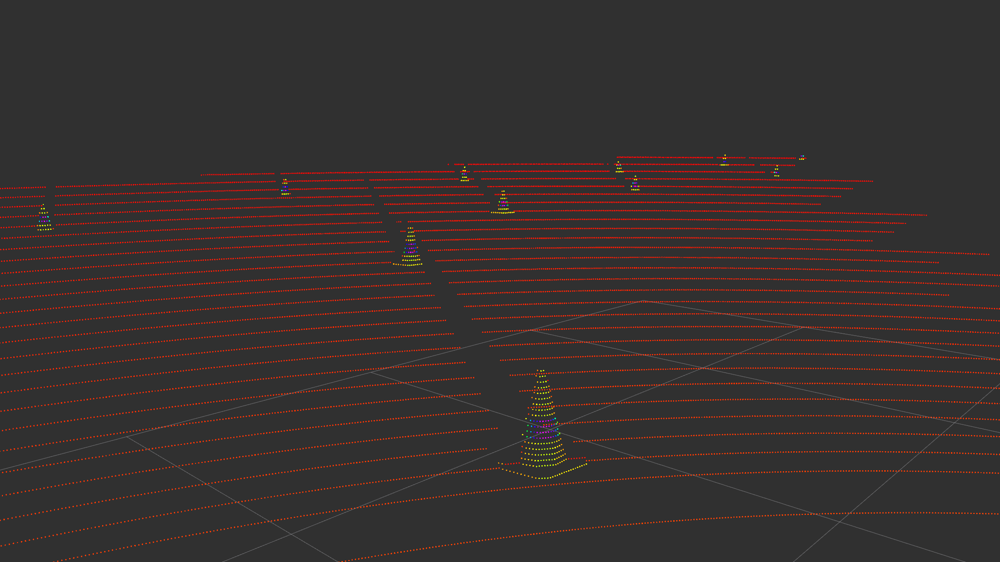

# BetterLiDAR.Gazebo

## 背景

Gazebo原生雷达只返回点云空间位置，不返回随距离和入射角衰减的强度信息。
故自定义雷达插件，使得点云强度更加接近真实情况。

## 环境

- Gazebo Harmonic
- Ubuntu 22.04 Jammy
- ROS2 Humble

下载依赖：`sudo apt install nlohmann-json3-dev`

## 目录

``` text
.
├── CHANGELOG.md
├── CMakeLists.txt
├── license
├── package.xml
├── README.md
├── scripts  # python脚本目录
│   ├── write_material.py       # 写入材质extras属性到GLB文件
│   ├── check_material.py       # 打印材质extras属性
│   ├── clear_material.py       # 清除材质extras属性
│   └── gen_channel_texture.py  # 生成通道纹理（水平偏移、距离上下限）
└── src
    ├── plugin   # BetterLiDAR雷达插件本体
    │   ├── <files>  
    │   ├── glad     
    │   └── shader   
    └── example  # 使用示例场景
        ├── config
     	│   └── lidar.rviz      # rviz2 配置文件
     	├── launch
     	│   ├── simulation_basic.launch.py # 启动基础场景（圆柱、球、方块、锥体）
     	│   └── simulation_cone.launch.py  # 启动锥桶赛道场景
     	├── lidar
     	│   ├── AT128.ctex      # AT128P 雷达通道纹理（水平偏移、距离上下限）
     	│   └── AT128P.xacro    # AT128P 雷达定义（各种参数）
     	├── models
     	│   ├── cone_map        # 锥桶赛道地图
     	│   ├── blue_cone       # 蓝色锥体
     	│   └── yellow_cone     # 黄色锥体
     	└── worlds
     	    ├── basic_world.sdf # 基础场景（圆柱、球、方块、锥体）
     	    └── cone_world.sdf  # 锥桶赛道场景
```

## 运行

```bash
# 编译
colcon build --packages-select better_lidar --cmake-args -DCMAKE_BUILD_TYPE=Release
```

```bash
# 运行：基础场景（圆柱、球、方块、锥体）
source install/setup.bash
ros2 launch better_lidar simulation_basic.launch.py
```

```bash
# 运行：锥桶赛道场景
source install/setup.bash
ros2 launch better_lidar simulation_cone.launch.py
```

```bash
# 关闭进程
pkill -f "gz sim" && pkill -f "ros2" && pkill -f "rviz2"
```

